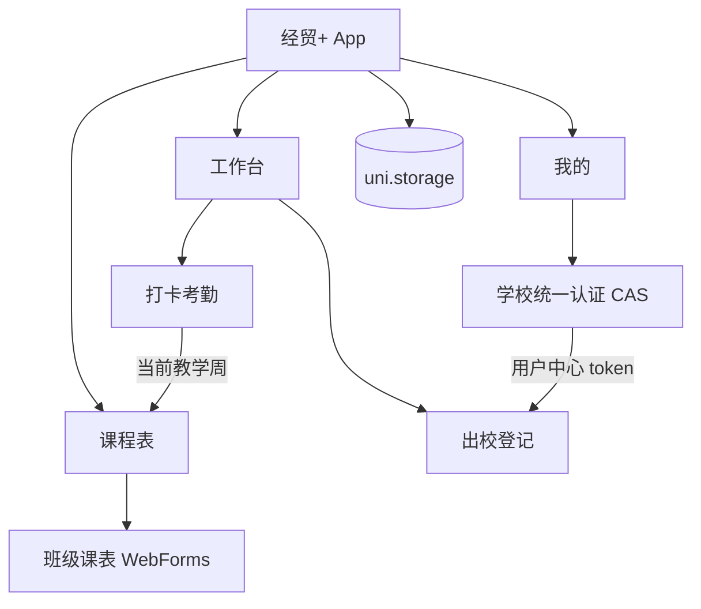

# 经贸+ · 校园工具箱

> 河南经贸职业学院校园服务聚合应用 · 非官方个人项目


「经贸+」把分散在公众号、旧版 App 和学校网页里的校园服务收进一个 App：课程表、出校登记、打卡考勤。项目基于 **uni-app + Vue 3**，当前以 Android 为主，H5 仅用于开发预览。

> 本项目为个人作品，与河南经贸职业学院官方无关。所有接口仅用于使用者本人有权访问的学校系统，不提供批量请求、自动打卡或自动提交申请等能力。

## 目录

- [功能总览](#功能总览)
- [技术栈](#技术栈)
- [架构](#架构)
- [目录结构](#目录结构)
- [快速开始](#快速开始)
- [使用说明](#使用说明)
- [打包 Android](#打包-android)
- [数据与隐私](#数据与隐私)
- [已知限制](#已知限制)
- [路线图](#路线图)
- [FAQ](#faq)
- [贡献](#贡献)
- [免责声明](#免责声明)
- [许可证](#许可证)
- [接口文档](#接口文档)

---

## 功能总览

| 模块 | 能力 |
| --- | --- |
| 课程表 | 原生周课表、院系/班级导入、周次切换、手动加课、公众号链接兜底、每日自动刷新 |
| 出校登记 | 原生记录列表、状态筛选、离校申请、申请详情、统一认证 / 微信链接两种凭证 |
| 打卡考勤 | 原生打卡、今日签到记录、学号密码登录、勾选记住密码后自动续期 |
| 我的 | 统一认证登录、学校头像/姓名/学号、主题配色、数据管理、关于 |
| 外观 | 默认校徽蓝，另有青绿、紫罗兰、活力橙、玫红 |

### 课程表

- 首次使用选择院系和班级，从学校公开班级课表页导入，无需登录
- 原生周视图，可按周切换；有考勤凭证时自动定位当前教学周，否则显示全部
- 展示课程、教室、教师、周次；支持手动加课（仅本机，带「手动」标记）
- 支持从剪贴板读取公众号课表链接作为兜底
- 每天首次进入课程表自动刷新；刷新失败保留上次缓存

### 出校登记

- 原生记录列表：状态筛选（未出校 / 待返校 / 已返校 / 超时）、下拉刷新、上拉加载
- 原生离校申请：离校/返校时间、事由、交通方式、目的地
- 原生申请详情：状态、预计/实际时间、事由、交通方式、目的地
- 优先复用「我的」统一认证 token；没有登录时使用已保存的微信链接 token
- 未登录且没有有效链接时，点击工作台卡片进入配置页；已登录时长按卡片也可进入配置页

### 打卡考勤

- 原生打卡页：立即打卡、今日签到记录、学校签到记录入口
- 打卡使用手机定位（GCJ-02），调用学校考勤接口
- 考勤系统与统一认证是两套独立账号体系，需要单独验证一次
- 勾选「记住密码」后，考勤凭证到期前自动续期；密码仅在本机做简单混淆，不是加密

### 我的与主题

- 学校统一认证登录，登录后同步学校头像、姓名、学号、学院班级
- 统一认证密码不保存；登录凭证保存在本机
- 默认校徽蓝 `#004AAB`，可切换青绿、紫罗兰、活力橙、玫红
- 导航栏、Tab 图标、按钮、卡片底色全局跟随主题

---

## 技术栈

| 项目 | 选型 |
| --- | --- |
| 应用框架 | uni-app 3（Vue 3 组合式 API） |
| 语言 | JavaScript |
| 构建工具 | Vite 5 |
| 样式 | 原生 CSS + CSS Variables 主题 |
| 平台 | Android（主）、H5（开发预览） |
| 打包 | HBuilderX 云打包 / 离线打包 |
| 数据存储 | `uni.storage`（仅本机） |

---

## 架构



### 认证与数据流

- **统一认证**：在「我的」打开学校 CAS 页面，登录成功后 WebView 从回调地址提取 token，用于出校登记和个人信息
- **考勤**：考勤系统有独立 token，通过学号密码 + openid 换取，与统一认证 token 不通用
- **课程表**：读取学校公开 WebForms 页面，不需要登录；当前教学周可选地复用考勤 token

---

## 目录结构

```text
.
├── src/
│   ├── config/
│   │   └── school.js          # 学校域名、接口基址、登录链接构造
│   ├── utils/
│   │   ├── link.js            # 出校登记链接/token 解析与存储
│   │   ├── leave.js           # 出校登记接口
│   │   ├── person.js          # 个人信息与头像
│   │   ├── kq.js              # 考勤登录、凭证、打卡
│   │   ├── course.js          # 课表查询、缓存、当前周
│   │   ├── course-parse.js    # 课表 HTML 解析
│   │   └── theme.js           # 主题与导航栏/Tab 配色
│   ├── pages/
│   │   ├── course/            # Tab：课程表（启动页）
│   │   ├── workbench/         # Tab：工作台
│   │   ├── mine/              # Tab：我的
│   │   ├── tool/
│   │   │   ├── leave/         # 出校登记：列表/申请/详情
│   │   │   ├── kq/            # 打卡考勤
│   │   │   ├── register/      # 出入校登记配置
│   │   │   ├── course-bind/   # 选择班级
│   │   │   └── course-add/    # 手动加课
│   │   ├── webview/           # 通用内嵌浏览器
│   │   └── about/             # 关于与风险声明
│   ├── static/tabbar/         # Tab 图标（按主题生成）
│   ├── pages.json             # 路由与 tabBar
│   └── manifest.json          # App 配置与权限
├── scripts/
│   └── gen-tab-icons.mjs      # 生成 Tab 图标
├── docs/
│   └── api-notes.md           # 学校接口参考（非官方）
├── index.html
└── package.json
```

---

## 快速开始

### 环境要求

- Node.js 18+
- npm
- HBuilderX（运行/打包 App 时需要）

### 安装与预览

```bash
npm install
npm run dev:h5     # H5 预览，仅用于 UI 调试
npm run dev:app    # App 开发模式，配合 HBuilderX 基座运行
```

> H5 预览受浏览器 CORS 限制，出校登记、考勤、课表等学校接口可能请求失败；完整功能请运行 Android App。

### 构建

```bash
npm run build:h5    # 构建 H5
npm run build:app   # 构建 App 资源，输出 dist/build/app
```

构建 App 资源后，可用 HBuilderX 导入 `dist/build/app`，或直接导入项目根目录运行/打包。

---

## 使用说明

### 1. 登录统一认证

1. 打开「我的」→「去登录」
2. 在打开的学校统一身份认证页面完成登录
3. 登录成功后自动返回，显示学校头像、姓名、学号与学院班级
4. App 会自动勾选认证页的「记住我」，token 到期后通常可静默续期

统一认证密码不会保存在 App 中，仅保存登录 token。

### 2. 出校登记

- 已登录统一认证：工作台 →「出校登记」直接进入记录列表
- 未登录：在微信中复制带 token 的登记链接，回到 App 后工作台会提示保存；也可长按「出校登记」卡片进入配置页手动粘贴
- 记录列表支持状态筛选、下拉刷新和上拉加载
- 离校申请需满足学校时间规则（默认最早 06:30、最晚 22:00，离校/返校间隔至少 1 小时）

### 3. 打卡考勤

1. 工作台 →「打卡考勤」
2. 首次使用输入学号和密码，获取考勤凭证
3. 勾选「记住密码」后，凭证到期前会自动续期
4. 点击「立即打卡」，App 会获取定位并调用学校考勤接口

考勤系统与统一认证不互通，因此需要单独登录一次，属于学校系统限制。

### 4. 课程表

- 首次使用选择院系和班级，导入课表
- 也可从剪贴板读取公众号课表链接
- 顶部「管理」支持手动加课、切换班级、取消绑定
- 每天首次进入课程表自动刷新；刷新失败显示上次缓存

### 5. 切换主题

「我的」→「外观」，选择配色后全局生效。

---

## 打包 Android

1. 安装 [HBuilderX](https://www.dcloud.io/hbuilderx.html)
2. 注册并登录 DCloud 账号，完成实名认证
3. HBuilderX 导入项目根目录
4. 打开 `src/manifest.json`，确认应用名称、包名和 AppID
5. 菜单「发行 → 原生 App-云打包」，选择 Android 和测试证书
6. 打包完成后下载 APK 安装

> 云打包受 DCloud 免费额度限制；离线打包需要单独下载离线 SDK 并申请离线 AppKey，本项目不包含这些材料。

App 需要以下权限：

| 权限 | 用途 |
| --- | --- |
| `INTERNET` | 请求学校接口、加载学校页面 |
| `ACCESS_FINE_LOCATION` / `ACCESS_COARSE_LOCATION` | 考勤打卡定位 |

学校部分老系统仍使用 HTTP，因此 manifest 开启了 `usesCleartextTraffic`。

---

## 数据与隐私

### 本机存储

所有持久化数据通过 `uni.storage` 保存在本机；除访问学校系统所需的请求外，不会上传到其他服务器。

| 数据 | 存储键 | 说明 |
| --- | --- | --- |
| 统一认证 token | `jm_login_token` | 出校登记、个人信息 |
| 登记链接 / 模式 | `jm_register_link`、`jm_register_mode` | 微信链接兜底 |
| 个人信息缓存 | `jm_person` | 头像、姓名、学号、学院班级 |
| 考勤凭证 | `jm_kq_auth` | 24 小时有效 |
| 考勤账号密码 | `jm_kq_cred` | 仅勾选「记住密码」时保存，混淆存储，**不是加密** |
| 考勤 openid | `jm_kq_openid` | 登录接口需要 |
| 课程表配置/缓存 | `jm_course_selection`、`jm_course_auth`、`jm_course_cache`、`jm_course_manual`、`jm_course_last_refresh` | 班级、链接、缓存、手动课程 |
| 主题 | `jm_theme` | 配色偏好 |

### 隐私约定

- 仓库中不包含任何真实姓名、学号、手机号、身份证号、头像 key、openid 或 token
- 统一认证密码不保存；考勤密码为可选项，且只是简单混淆
- 共用设备不建议勾选「记住密码」；手机被 root 或备份可能读取本地数据
- `docs/api-notes.md` 记录了校内系统接口研究，仅用于个人维护和二次开发；请勿用于未授权访问
- 请勿在 Issue、截图或提交记录中粘贴真实凭证

### HTTP 明文

学校部分系统仍使用 HTTP，manifest 因此开启了 `usesCleartextTraffic`（Android 上是全局开关）。App 目前只访问上述学校 HTTP 域名，HTTPS 域名保持默认校验；登录仍应确认页面来源。

---

## 已知限制

- 考勤系统与统一认证 token 不通用，必须单独登录一次
- 统一认证 token 有效期约 24 小时；CAS 持久票据时长由学校服务端决定
- 水电/空调缴费暂未接入，相关工作暂停
- H5 预览受 CORS 限制，学校接口可能不可用
- 学校接口和页面结构可能随时调整，App 不保证长期可用
- 当前主要针对 Android，iOS 未测试
- 远程开门等涉及实体设备的功能未实现

---

## 路线图

- [ ] 水电/空调缴费（暂缓，待后续评估）
- [ ] 增加更多校园服务入口（视学校系统开放情况）
- [ ] 补充课表解析和链接解析的自动化测试
- [ ] 改进网络错误提示和接口降级策略
- [ ] 评估 iOS / 跨平台构建

---

## FAQ

**为什么打卡考勤要重新登录？**

考勤系统和学校统一认证是两套独立账号体系，考勤接口只认自己的 token。勾选「记住密码」后只需首次登录，之后会自动续期。

**水电/空调缴费为什么没有？**

该功能暂时移除，相关接口研究保留在 `docs/api-notes.md` 第 7 节，待后续评估。

**H5 预览为什么接口报错？**

浏览器有 CORS 限制，学校接口不返回跨域头。App 端使用原生请求和 WebView，不受该限制。

**App 会上传我的数据吗？**

不会上传到任何自建服务器。除向学校系统发起必要请求外，数据只保存在本机。

**可以自动打卡吗？**

不可以。打卡需要用户主动点击并获取定位，项目不提供自动化打卡能力。

---

## 贡献

这是一个个人项目，欢迎 Issue 和 PR，但请注意：

- 不要提交真实账号、token、openid、姓名、学号或登记链接
- 调试接口时使用假数据，不要批量请求学校系统
- 涉及支付、实体门禁、自动打卡的改动需要特别说明和谨慎评估

---

## 免责声明

- 本项目为非官方个人作品，与河南经贸职业学院及其附属系统无关
- 使用本项目产生的任何后果由使用者自行承担
- 请遵守学校网络与信息系统使用规定，仅访问本人有权访问的数据
- 不提供自动提交申请、自动打卡、批量请求或绕过权限的功能
- 学校系统调整可能导致功能失效，作者不保证持续维护

---

## 许可证

本仓库暂未附带开源许可证。未经作者许可，请勿将代码或接口笔记用于商业用途或二次分发。

---

## 接口文档

- [学校系统接口参考（非官方）](docs/api-notes.md)

接口文档包含出校登记、统一认证、考勤、课程表以及暂缓的水电/空调缴费研究记录，供个人维护和二次开发参考。
